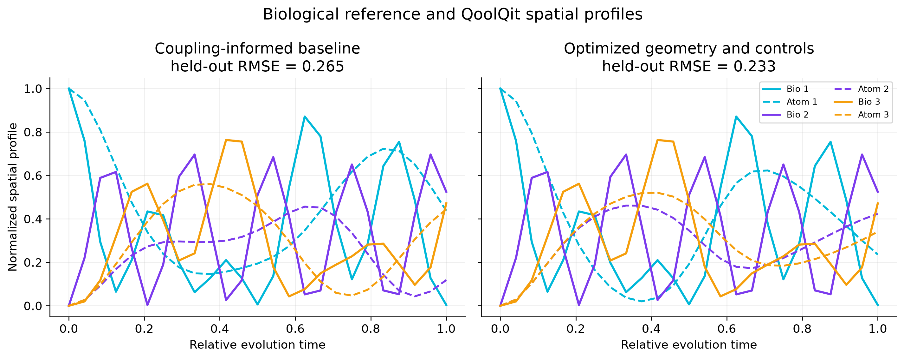

# BioRydberg 2.0: Geometry-Aware Quantum Transport with Rydberg Atom Arrays

BioRydberg 2.0 tests whether constrained neutral-atom geometry and laser controls can improve a spatial-pattern match to a simplified biological excitation-transport network. The neutral-atom programs are compiled and executed with QoolQit; the biological reference uses direct matrix exponentiation.

The models are physically different. The biological Hamiltonian contains hopping terms, while the standard driven Rydberg model contains laser coupling, detuning, and diagonal occupation interactions proportional to `1/r^6`. Normalized Rydberg occupations in this project are spatial-profile diagnostics, not biological excitation probabilities or quantum-state fidelities.

## Verified result

Using two reproducible optimizer seeds for geometry and two for controls, the held-out three-site spatial-profile RMSE decreased from **0.26497** to **0.23288**, a **12.1% reduction**. Even valid time indices were used for tuning; odd indices were held out. All 25 evaluation points exceeded the `1e-6` total-occupation threshold.

This modest improvement supports only the narrow pattern-matching hypothesis. It does not establish Hamiltonian equivalence, biological fidelity, quantum advantage, or better physical transport.



## Project workflow

1. Build a Hermitian single-excitation biological Hamiltonian.
2. Evolve it with `exp(-iHt)` and verify probability conservation.
3. Convert coupling magnitudes into a deterministic 2D layout heuristic.
4. Construct and compile a QoolQit `QuantumProgram` for an `AnalogDevice`.
5. Execute `LocalEmulator` from a localized Rydberg initial state.
6. Record raw site occupations and total occupation.
7. Mask profiles below the declared occupation threshold and normalize valid profiles.
8. Optimize a bounded triangle geometry, followed by constant amplitude, detuning, and duration.
9. Report tuning and held-out RMSE separately.
10. Run one limited seven-site feasibility benchmark without optimization.

## Repository structure

```text
src/                  Reference model, mapping, QoolQit execution, metrics, optimization, plots
experiments/          Original experiments plus the reproducible contest study
data/                 Three-site and illustrative seven-site matrices
tests/                Unit, integration, and deliverable checks
results/              Configurations, numerical tables, JSON summary, PNG/SVG figures
submission/           Executed contest notebook and exactly two presentation slides
docs/                  Learning guide and final technical report
presentation/          Earlier slide outline retained as project history
```

## Tested environment

- Python 3.12.9
- QoolQit 1.4.0
- Local `QutipBackendV2` through QoolQit `LocalEmulator`
- Windows 11 development environment

QoolQit 1.4.0 is explicitly pinned in `requirements.txt`. PyPI identifies 1.4.0 as the current release as of this submission build.

## Installation

```powershell
python -m venv .venv
.venv\Scripts\Activate.ps1
python -m pip install --upgrade pip
python -m pip install -r requirements.txt
python -c "import qoolqit; print(qoolqit.__version__)"
```

The last command must print `1.4.0`.

## Reproduce the study

Run all original and new experiments:

```powershell
$env:MPLBACKEND = "Agg"
python run_all.py
```

Run only the contest study with the submitted evaluation budget:

```powershell
$env:MPLBACKEND = "Agg"
python experiments/05_contest_study.py --maxiter 3 --popsize 4 --n-times 25
```

Execute the contest notebook:

```powershell
python -m jupyter nbconvert --to notebook --execute --inplace `
  --ExecutePreprocessor.timeout=600 `
  submission/BioRydberg_2_0_Pasqal_QoolQit_Contest.ipynb
```

On restricted systems, point `JUPYTER_CONFIG_DIR`, `JUPYTER_DATA_DIR`, and `JUPYTER_RUNTIME_DIR` to writable local directories.

Run tests:

```powershell
python -m pytest -q -p no:cacheprovider
```

## Experiments

- **A - baseline validation:** two- and three-site Hermiticity, dimensions, localized state preparation, and conservation under direct matrix exponential evolution.
- **B - neutral-atom dynamics:** a real three-atom QoolQit register, drive, compilation, local emulation, site occupation, and interaction-matrix validation.
- **C - model comparison:** raw occupation, non-conserved total occupation, thresholded normalized profiles, tuning RMSE, and held-out RMSE.
- **D - geometry optimization:** the third triangle vertex is optimized within finite bounds; coordinates are centered and rescaled to unit minimum separation.
- **E - control optimization:** constant amplitude, detuning, and dimensionless duration are optimized with the same deterministic method and declared budgets.
- **F - seven-site extension:** one feasible local-emulator run on the illustrative seven-site matrix. No seven-site optimization was attempted.

## Numerical findings

| Configuration | Tuning RMSE | Held-out RMSE | Notes |
|---|---:|---:|---|
| Coupling-informed baseline | 0.25434 | 0.26497 | `Omega=0.8`, `Delta=0`, duration `10` |
| Optimized geometry | 0.23515 | 0.24335 | 32 evaluations for the selected seed |
| Optimized geometry and controls | 0.22255 | 0.23288 | 48 control evaluations for the selected seed |
| Seven-site limited benchmark | 0.17906 | 0.18575 | Illustrative matrix; no optimization |

The seven-site RMSE is not evidence that the larger model performs better. Its number of sites, trajectory, and optimization budget differ, so it serves only as a feasibility check.

Additional verified values:

- Biological probability-conservation error: `2.22e-15` (two sites), `2.44e-15` (three sites).
- Three-site biological target peak: `0.79973` at dimensionless time `5.25753`.
- Selected optimized controls: amplitude `1.15908`, detuning `0.33095`, duration `7.12959`.
- Total contest-study runtime in the final validation run: `27.18 s`.

Complete machine-readable values are in [`results/study_summary.json`](results/study_summary.json) and [`results/tables/study_metrics.csv`](results/tables/study_metrics.csv).

## Scientific assumptions and limitations

- Relative-time alignment does not assert a shared physical timescale.
- The localized emulator initial state aligns the starting spatial condition but does not make the Hamiltonians equivalent.
- A global drive can enter zero-, one-, and multiple-excitation sectors.
- Odd/even time splitting tests interpolation-level generalization within one trajectory, not transfer to a new network.
- The search budget and two seeds do not establish global optimality.
- The seven-site matrix is FMO-inspired and illustrative, not a validated literature FMO Hamiltonian.
- No cloud emulator, noise model, or QPU was used.

## Research provenance

**Previous foundation:** biological excitation reference models, the original QoolQit experiments, an initial coupling-to-geometry heuristic, illustrative datasets, and the first comparison notebook.

**New contest work:** localized initial-state alignment, explicit invalid-profile masking, bounded two-seed geometry/control optimization, held-out evaluation, the seven-site benchmark, expanded plots and tests, the executed submission notebook, final documentation, and the two-slide presentation.

## Contest deliverables

- [Executed notebook](submission/BioRydberg_2_0_Pasqal_QoolQit_Contest.ipynb)
- [Two-slide PDF](submission/BioRydberg_2_0_Pasqal_Contest.pdf)
- [Editable two-slide PowerPoint](submission/BioRydberg_2_0_Pasqal_Contest.pptx)
- [Final technical report](docs/FINAL_TECHNICAL_REPORT.md)

## Official references

- [Pasqal QoolQit Contest](https://www.pasqal.com/resources/the-qoolqit-contest-is-live/)
- [QoolQit documentation](https://docs.pasqal.com/qoolqit/)
- [QoolQit source repository](https://github.com/pasqal-io/qoolqit)
- [QoolQit 1.4.0 on PyPI](https://pypi.org/project/qoolqit/)

## Author

Syed Marjan Ghazi
